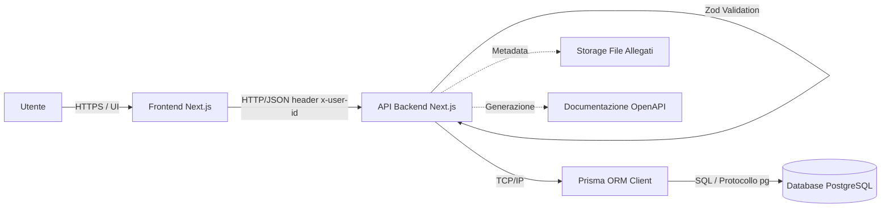

# Architettura v1 — Smart Maintenance / NordFacility

|  |  | 
| ----- | ----- | 
| **Team** | Team Sviluppo NordFacility (SimoRighi, manuel, nat, nicola, rzamp) | 
| **Cliente** | NordFacility S.r.l. | 
| **Data** | 21/10/2026 | 
| **Versione** | v1 — provvisoria per definizione, la confronterete con la v2 a dicembre | 

*L'architettura riflette lo stack attualmente in uso: Next.js come framework full-stack, Prisma come ORM e PostgreSQL (Supabase) come database relazionale.*

## Componenti

| Componente | Risponde di | Non risponde di | 
| ----- | ----- | ----- | 
| **Web Frontend (React/Next.js)** | Rendering delle interfacce utente, gestione dello stato lato client, interazione con l'utente (form segnalazioni, dashboard tecnici). | Validazione definitiva dei dati, accesso diretto e non mediato al database. | 
| **API / Backend (Next.js)** | Ricezione richieste HTTP, validazione robusta dei payload (tramite **Zod**), orchestrazione della logica di business (es. `SuggerimentoAI`, `Assegnazione`), garanzia delle transazioni per `StoricoStato` e `LogAudit`. | Memorizzazione fisica dei file allegati (solo metadata in DB), erogazione del database. | 
| **Data Access Layer (Prisma)** | Introspezione dello schema (`db:pull`), generazione di un client type-safe TypeScript, conversione delle query in SQL nativo tramite `pg`. | Definizione della struttura delle tabelle (gestita a monte su Supabase). | 
| **Database (PostgreSQL / Supabase)** | Persistenza sicura e strutturata (entità utente/tecnico, gerarchie di `Luogo`, integrità referenziale su interventi e allegati). | Logica applicativa, validazione di regole di business complesse non esprimibili in DDL. | 

## Diagramma

## Dipendenze

| Componente | Dipende da | Se si ferma | 
| ----- | ----- | ----- | 
| **API Backend** | Database PostgreSQL | Impossibile leggere o scrivere dati. Il backend restituirà errori 500 formattati centralmente. Nessuna segnalazione può progredire di stato. | 
| **Web Frontend** | API Backend | L'interfaccia utente carica a vuoto, non potendo recuperare i dati dei luoghi, delle categorie o le segnalazioni aperte. | 
| **Sistema Allegati** | Storage Esterno | Impossibile caricare nuove foto o PDF per le segnalazioni/interventi, pur mantenendo attiva la gestione testuale dei ticket. | 

## Fuori dal perimetro

*   **Autenticazione Crittografica Completa (Fase attuale):** Nonostante il DB preveda `passwordHash` e `UtenteRuolo`, attualmente l'identificazione è simulata tramite l'header `x-user-id`. L'implementazione di sessioni sicure (es. JWT o NextAuth) è posticipata.
*   **Motore di Intelligenza Artificiale:** La tabella `SuggerimentoAi` immagazzina l'esito e i dati suggeriti, ma l'engine LLM che elabora la descrizione per derivare `categoriaSuggerita` e `prioritaSuggerita` opera fuori dal perimetro diretto del backend di base (es. chiamata API esterna).
*   **Storage Fisico dei File:** La tabella `Allegato` memorizza il `percorsoStorage` e il `tipoMime`, ma il salvataggio fisico dei blob non avviene sul DB relazionale (si presume un bucket S3 o lo storage di Supabase).
*   **Migrazioni Prisma Standard:** Il database è gestito esternamente. I comandi `prisma migrate` sono espressamente vietati in favore di `prisma db pull`.
