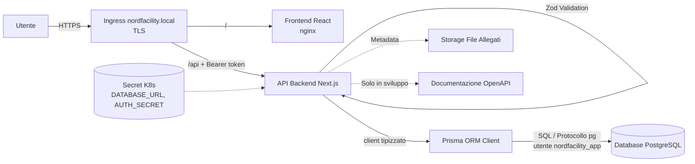
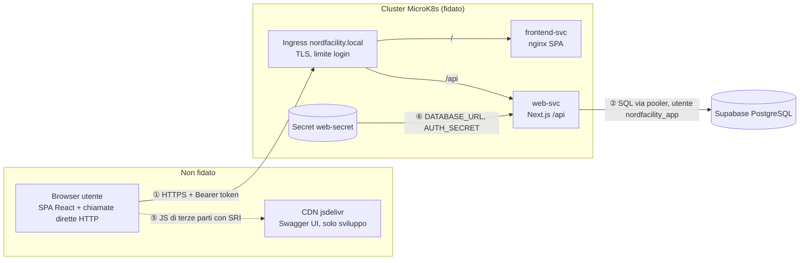

# Architettura v1 — Smart Maintenance / NordFacility

|  |  | 
| ----- | ----- | 
| **Team** | Team Sviluppo NordFacility (SimoRighi, manuel, nat, nicola, rzamp) | 
| **Cliente** | NordFacility S.r.l. | 
| **Data** | 21/10/2026 · aggiornata il 25/11/2026 (lezioni 5–10) | 
| **Versione** | v1.2 — provvisoria per definizione, la confronterete con la v2 a dicembre | 

*L'architettura riflette lo stack attualmente in uso: Next.js come framework full-stack, Prisma come ORM e PostgreSQL (Supabase) come database relazionale.*

## Componenti

| Componente | Risponde di | Non risponde di | 
| ----- | ----- | ----- | 
| **Web Frontend (React + Vite, servito da nginx)** | Rendering delle interfacce utente, gestione dello stato lato client, interazione con l'utente (form segnalazioni, dashboard tecnici). | Validazione definitiva dei dati, accesso diretto e non mediato al database. | 
| **API / Backend (Next.js)** | Autenticazione (login, token firmati) e autorizzazione per ruolo e assegnazione, ricezione richieste HTTP, validazione robusta dei payload (tramite **Zod**), orchestrazione della logica di business (es. `SuggerimentoAI`, `Assegnazione`), garanzia delle transazioni per `StoricoStato` e `LogAudit`. | Memorizzazione fisica dei file allegati (solo metadata in DB), erogazione del database. | 
| **Data Access Layer (Prisma)** | Introspezione dello schema (`db:pull`), generazione di un client type-safe TypeScript, conversione delle query in SQL nativo tramite `pg`. | Definizione della struttura delle tabelle (gestita a monte su Supabase). | 
| **Database (PostgreSQL / Supabase)** | Persistenza sicura e strutturata (entità utente/tecnico, gerarchie di `Luogo`, integrità referenziale su interventi e allegati). Immutabilità di `log_audit` (trigger). | Logica applicativa, validazione di regole di business complesse non esprimibili in DDL. | 
| **Ingress (MicroK8s, ingress-nginx)** | Terminazione TLS, redirect HTTP → HTTPS, instradamento `/api` → backend e `/` → frontend, limite di richieste sul login. | Autenticazione e autorizzazione (le fa il backend). | 

## Diagramma

## Dipendenze

| Componente | Dipende da | Se si ferma | 
| ----- | ----- | ----- | 
| **API Backend** | Database PostgreSQL | Impossibile leggere o scrivere dati. Il backend restituirà errori 500 formattati centralmente. Nessuna segnalazione può progredire di stato. | 
| **Web Frontend** | API Backend | L'interfaccia utente carica a vuoto, non potendo recuperare i dati dei luoghi, delle categorie o le segnalazioni aperte. | 
| **Sistema Allegati** | Storage Esterno | Impossibile caricare nuove foto o PDF per le segnalazioni/interventi, pur mantenendo attiva la gestione testuale dei ticket. | 

## Fuori dal perimetro

*   **Single sign-on / provider di identità esterni:** il login è locale (email + `password_hash` bcrypt, token HMAC firmato dal backend). Integrazioni con SSO aziendale, recupero password e revoca dei token prima della scadenza non sono ancora previsti.
*   **Motore di Intelligenza Artificiale:** La tabella `SuggerimentoAi` immagazzina l'esito e i dati suggeriti, ma l'engine LLM che elabora la descrizione per derivare `categoriaSuggerita` e `prioritaSuggerita` opera fuori dal perimetro diretto del backend di base (es. chiamata API esterna).
*   **Storage Fisico dei File:** La tabella `Allegato` memorizza il `percorsoStorage` e il `tipoMime`, ma il salvataggio fisico dei blob non avviene sul DB relazionale (si presume un bucket S3 o lo storage di Supabase).
*   **Migrazioni Prisma Standard:** Il database è gestito esternamente. I comandi `prisma migrate` sono espressamente vietati in favore di `prisma db pull`. Gli script SQL di sicurezza (`web/prisma/sql/`) si eseguono a mano dal SQL editor di Supabase.

## Confini di fiducia

Un confine di fiducia è ogni punto del diagramma dove i dati passano da un lato
fidato a uno che non lo è (o lo è meno). Per ciascuno: cosa c'è dentro, cosa
c'è fuori, cosa si verifica quando lo si attraversa. Ogni confine rimanda a una
riga della checklist in `docs/security-review.md`.

Prima stesura il 25/11/2026 sul branch `k8s` (`559e118`). Aggiornata dopo le
correzioni C1–C11 dello stesso giorno.

| # | Confine | Dentro (fidato) | Fuori (non fidato) | Cosa si verifica attraversandolo |
|---|---|---|---|---|
| 1 | Browser → Ingress → `web-svc` (`/api/*`) | Route handler, service, Prisma | Browser, SPA, qualunque richiesta HTTP diretta (curl, Swagger) | **Trasporto**: solo HTTPS, redirect da HTTP (`k8s/ingress.yaml`). **Identità**: token `Bearer` firmato HMAC-SHA256 con `AUTH_SECRET`, con scadenza; l'utente viene riletto dal DB a ogni richiesta (`web/src/server/auth.ts`). **Login**: bcrypt, 429 dopo 5 errori, 20 req/min per IP sull'Ingress. **Ruolo**: `requireRole` su ogni scrittura. **Input**: zod su ogni body e query (→ checklist #1, #2, #3). |
| 2 | Backend → database Supabase | Database PostgreSQL | Backend (se compromesso), rete verso il pooler Supabase | Credenziali solo nel Secret. Query solo tramite Prisma (parametrizzate). Utente `nordfacility_app` senza DELETE, DROP né modifica dei ruoli. Trigger che rifiuta UPDATE/DELETE su `log_audit` anche per il proprietario (`web/prisma/sql/`, → #4, #7). **Da applicare su Supabase.** |
| 3 | Backend → dipendenze npm | Codice nostro in `web/src` | Codice delle dipendenze e dei pacchetti transitivi | Lockfile committati, `npm ci`, immagini base con versione fissata. `npm audit` del 25/11: 0 vulnerabilità su backend e frontend (→ #5). |
| 4 | Utente → dati di altri utenti / altre segnalazioni | Le segnalazioni di competenza dell'utente | Segnalazioni di altri, email di altri utenti, segnalazioni non assegnate al tecnico | `filtroVisibilita()` **dentro la query**: Responsabile/Admin tutto, Tecnico le assegnate, Segnalatore le proprie. Fuori perimetro → 404. Cambio stato solo sulle assegnate. Email escluse dalle risposte (→ #2, test `visibilita.test.ts`). |
| 5 | Browser → CDN esterna (`/api/docs`) | Pagina servita dal backend | JavaScript da `cdn.jsdelivr.net` | Versione fissata + `integrity` sha384 su CSS e JS. Spento in produzione (`API_DOCS=false` nel cluster). |
| 6 | Amministratore del cluster → Secret Kubernetes | Pod `web` | Chi ha `kubectl`, il repository Git | Il Secret è solo base64. In Git solo `secret-example.yaml` con segnaposto; `k8s/secret.yaml`, `.env*` e i certificati TLS sono in `.gitignore`. Senza `AUTH_SECRET` valido il Pod non parte (→ #4). |

| Confine | Righe checklist | Stato |
|---|---|---|
| 1 | #1, #2, #3 | Verificato da test e con `curl` sul build di produzione. |
| 2 | #4, #7 | Script verificati nei test; **da eseguire su Supabase** (C6). |
| 3 | #5 | OK al 25/11; va ripetuto a ogni PR. |
| 4 | #2 | Verificato da test (bug 42). |
| 5 | — | OK. |
| 6 | #4 | OK. |

### Cosa cambia rispetto alla v1 di lezione 1

Nella v1 la freccia `Frontend → API` riportava "header `x-user-id`" come se
fosse un meccanismo di identità. Non c'era nessun confine, e il database stava
nello stesso blocco fidato del backend. Mancavano Ingress, Kubernetes e Secret,
arrivati nelle lezioni 5 e 9.

L'autovalutazione del 25/11 ha mostrato che `x-user-id` **non** autenticava
nessuno e che il confine ④ esisteva solo nel disegno. Le correzioni dello stesso
giorno hanno introdotto:
- login con token firmato al posto di `x-user-id`;
- visibilità per ruolo e per assegnazione nelle query;
- TLS sull'Ingress;
- audit immutabile e utente DB limitato.

Il confine più debole oggi è il ②: le protezioni sono pronte ma vanno ancora
applicate sul database reale.
