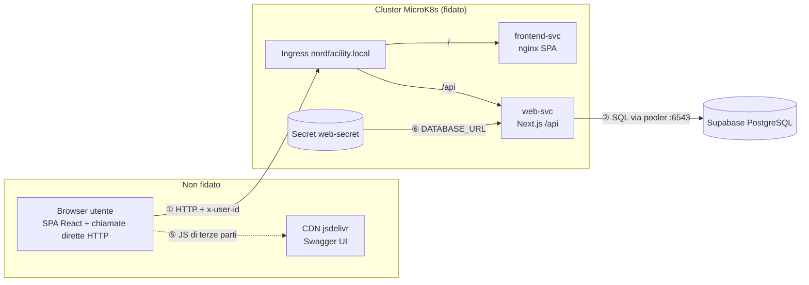

# Confini di fiducia — sezione da aggiungere a `docs/architecture-v1.md`

*Questo non è un file a sé stante: è la sezione "Confini di fiducia" da
incollare in coda al vostro `docs/architecture-v1.md` esistente, accanto al
diagramma dei componenti già disegnato nella lezione 1. Non ridisegnate tutto:
aggiungete dove passa la fiducia tra ciò che avete già.*

| | |
|---|---|
| **Progetto / cliente** | Smart Maintenance (NordFacility S.r.l.) |
| **Team** | Team 1 — SimoRighi, manuel, nat, nicola, rzamp |
| **Data** | 25/11/2026 |

## Confini di fiducia

*Un confine di fiducia è ogni punto del diagramma dove i dati passano da un
lato che considerate fidato a un lato che non lo è (o lo è meno). Per
ciascuno: cosa c'è dentro, cosa c'è fuori, cosa va verificato quando lo si
attraversa.*

Riferimento: stato del branch `k8s` al commit `559e118`.

| # | Confine | Dentro (fidato) | Fuori (non fidato) | Cosa si verifica attraversandolo |
|---|---|---|---|---|
| 1 | Browser → Ingress (`nordfacility.local`) → `web-svc` (Next.js `/api/*`) | Route handler Next.js, service, Prisma | Browser, SPA, qualunque richiesta HTTP diretta (curl, Swagger) | **Identità**: oggi solo l'header `x-user-id` (`web/src/server/auth.ts:27`), che il client sceglie liberamente: *non è un'autenticazione* (→ checklist #1, criticità C1). **Ruolo**: `requireRole()` su `POST /api/segnalazioni` e `PATCH /api/segnalazioni/:id/stato` (→ #2). **Input**: schemi zod in `web/src/server/validation/segnalazioni.ts`, body malformato → 400 (→ #3). Trasporto: l'Ingress è solo HTTP, nessun TLS (`k8s/ingress.yaml`). |
| 2 | Backend → database Supabase | Database PostgreSQL | Backend (se compromesso), rete pubblica verso il pooler Supabase | Credenziali solo in `DATABASE_URL` dal Secret Kubernetes, mai nel codice (→ #4). Query solo tramite Prisma (parametrizzate, niente SQL concatenato; l'unico `$queryRaw` è il `SELECT 1` dell'health check). **Da fare**: oggi i template usano l'utente `postgres` (amministratore). Va creato un utente applicativo con solo `SELECT/INSERT/UPDATE` sulle tabelle usate e **senza** `UPDATE/DELETE` su `log_audit` (→ C6). |
| 3 | Backend → dipendenze npm (`next`, `prisma`, `zod`, `pg`, `bcryptjs`) | Codice nostro in `web/src` | Codice delle dipendenze e dei loro pacchetti transitivi | `package-lock.json` committato in `web/` e in `frontend/frontendGestione/`, `npm ci` nei Dockerfile, immagini base con versione fissata (`node:22.12-alpine`, `nginx-unprivileged:1.27-alpine`). `npm audit` eseguito oggi: backend 7 vulnerabilità (1 critica su `next@16.4.0`), frontend 0 (→ #5, C4). |
| 4 | Utente → dati di altri utenti / altre segnalazioni | Le segnalazioni che l'utente può vedere o modificare in base al ruolo | Segnalazioni di altri segnalatori, dati personali (email) di altri utenti, segnalazioni non assegnate al tecnico | **Oggi non verificato lato server.** `GET /api/segnalazioni` e `GET /api/segnalazioni/:id` sono pubbliche e restituiscono tutte le segnalazioni con nome, cognome ed email di segnalatore, tecnici e responsabili (`segnalazioni.service.ts:39`). Un Tecnico può cambiare lo stato di *qualunque* segnalazione, anche non assegnata a lui (`cambiaStato`, `segnalazioni.service.ts:182`) (→ C2, C3). |
| 5 | Browser → CDN esterna (Swagger UI su `/api/docs`) | Pagina servita dal nostro backend | JavaScript scaricato da `cdn.jsdelivr.net` | Versione fissata (`swagger-ui-dist@5.29.5`, `web/src/app/api/docs/route.ts:3`) ma senza Subresource Integrity (`integrity=`). La documentazione resta esposta anche nel cluster (→ C7). |
| 6 | Amministratore del cluster → Secret Kubernetes | Pod `web` che legge `DATABASE_URL` | Chi ha accesso `kubectl` al cluster, il repository Git | Il Secret è solo base64, non cifrato. Il file reale `k8s/secret.yaml` è in `.gitignore`. In Git c'è solo `secret-example.yaml` con valori segnaposto; anche `config/dev.env` e `config/test.env` nella storia contengono solo `[PASSWORD]` (→ #4). |

*Collegate ogni confine, dove potete, a una riga della checklist in
`docs/security-review.md`: un confine senza un controllo verificato in
checklist è un confine solo disegnato, non ancora protetto.*

Riepilogo del collegamento confini → checklist:

| Confine | Righe checklist | Stato |
|---|---|---|
| 1 | #1, #2, #3 | Validazione OK. Ruoli parziali. **Autenticazione assente** (C1). |
| 2 | #4 | Secret OK. Privilegi DB da restringere (C6). |
| 3 | #5 | Lockfile OK. Vulnerabilità aperte su `next` (C4). |
| 4 | #2 | **Solo disegnato**: nessun filtro per proprietario o assegnazione (C2, C3). |
| 5 | — | Parziale: versione fissata, manca SRI (C7). |
| 6 | #4 | OK. |

## Cosa cambia rispetto alla v1 di lezione 1

Nel diagramma della v1 la freccia `Frontend → API` riportava "header
`x-user-id`" come se fosse un meccanismo di identità. Il diagramma non segnava
nessun confine, e il database era disegnato come parte dello stesso blocco
fidato del backend. Mancavano anche Ingress, Kubernetes e Secret, aggiunti
nelle lezioni successive.

Oggi abbiamo marcato l'Ingress → `web-svc` come primo confine (①) e dichiarato
in modo esplicito che `x-user-id` **non** autentica nessuno: chiunque raggiunga
`/api` può impersonare qualsiasi utente del seed. Abbiamo aggiunto come confini
separati la connessione a Supabase (②, che passa da Internet con un utente con
troppi privilegi), le dipendenze npm (③), l'isolamento tra i dati degli utenti
(④), la CDN di Swagger (⑤) e il Secret (⑥). Il confine ④ è quello più debole:
esiste solo nel disegno, non nel codice.
